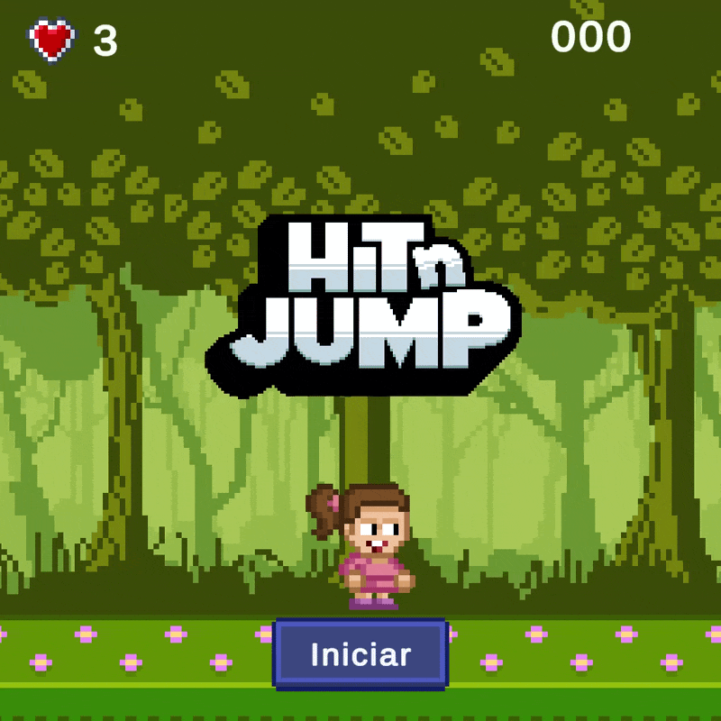

# Hit And Jump
Nivel básico creado con Unity

Este es un proyecto de videojuego de plataformas en 2D desarrollado como práctica y entorno de pruebas durante mi formación en un curso de **Domestika**. 

El objetivo principal de este proyecto ha sido aprender e implementar las mecánicas esenciales de desarrollo de videojuegos.
##  Características e Implementaciones Técnicas

El juego incluye las siguientes mecánicas programadas desde cero:

*   **Sistema de Movimiento y Animaciones:** Control del personaje con su respectivas animaciones (*Idle*, *Run*, *Jump*).
*   **Detección de Colisiones:** Uso de *colliders* y *triggers* para gestionar la interacción del personaje con el entorno, enemigos y objetos.
*   **Objetos :**
    *   **Monedas:** Suman puntos a la puntuación total del jugador.
    *   **Corazones:** Suman una vida al contador del jugador.
    *   **Obstáculos dañinos:** Restan todas las vidas y se vuelve al inicio del juego.
*   **Enemigos:** Los enemigos restan vida si el jugador se choca con ellos, pero mueren si el jugador salta encima de ellos. También detectan el final de la plataforma para no caer por ellas.
*   **Interfaz Gráfica:** Se muestran vidas y puntos del jugador, actualizados, en pantalla. Además se incorpora un menú de inicio con el logo y un botón que hace que se inicie la partida.

## Tecnologías Utilizadas

*   **Motor Gráfico:** Unity
*   **Lenguaje de Programación:** C#
*   **Assets:** Assets, música y sonidos proporcionados por el curso de Domestika.

## Cómo Jugar (Controles Básicos)

*   **Moverse:** Flechas de dirección / `A` y `D`
*   **Saltar:** Barra Espaciadora 

---

*Nota: Este repositorio se creó con fines estrictamente académicos y de aprendizaje.*

## Muestra del juego:

